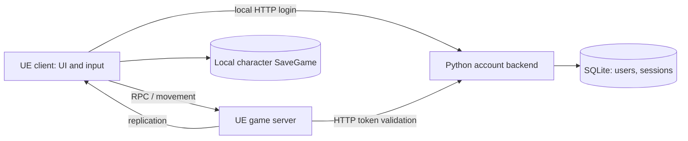

# OnlineTower — project status, architecture and team roadmap

> Later update on 2 November: the owner's new request adds parties of up to six and local matchmaking, with dungeon capacity changed from four to five. See [MATCHMAKING_FLOW_EN](MATCHMAKING_FLOW_EN.md) for current behavior and validation. The assessment below preserves the pre-change snapshot; party-three/global-ServerTravel restrictions no longer describe the new queue.

Snapshot: **2 November 2026**. Audited code baseline: `75551df`; the working tree was clean before the audit. [Русская версия](PROJECT_STATUS_RU.md).

## 1. Current stage

**Engineering assessment: a local multiplayer prototype, before a complete first-floor vertical slice.** The foundations for shared play exist, but the complete loop “trial → win/loss → one-time reward → persistence → reconnect” does not. A completion percentage would be arbitrary without agreed scope and acceptance criteria.

The first release covers one floor. Its final trial requires 12 participants in four teams of three, without automatic team filling; a player without a complete trio at the deadline loses. Three random regular abilities plus an ultimate belong to character creation, not to every match. Current owner instructions take precedence, followed by [PROJECT_DIRECTION.md](PROJECT_DIRECTION.md). This audit does not change those rules.

| Area | Implemented in code/content | Still incomplete |
|---|---|---|
| Startup and UI | Main menu, local character creation/selection, settings, pause, HUD, account/party panel | Unified flow into a persistent online character and session |
| Movement | Network CharacterMovement, predicted sprint, jump, server-executed roll | Latency/loss acceptance; roll remains a prototype |
| Combat | GAS, health, basic attack, six regular abilities in the pool, three unique selections, fixed ultimate, dummies, death/respawn | PvE enemies, complete match rules, balance and final animation |
| Accounts | Registration/login, tokens, SQLite, identity validation by the game server | Public service, account recovery, character/progression ownership |
| Multiplayer | Replication, party invitations/accept/decline/leave, portal waiting, single-party seamless travel | Independent trial instances, matchmaking, disconnect recovery |
| World | Separate menu, office hub, PvE, duel and final maps; procedural environments, materials and mountains | Trial gameplay content and final visual/performance acceptance |
| Persistence | Local character SaveGame; separate account SQLite storage | Trusted online characters, floor progression, results and rewards |
| Final trial | Map and “12 players / four trios” description | Team formation, deadlines, admission, outcome and 12-participant validation |

A trial map and a description of its rules do not implement those rules. The melee damage archetype's fixed Earthbreaker ultimate is provisional; other archetypes are not ready.

## 2. Architecture today

The project uses **one Unreal runtime module, `OnlineTower`, with logical subsystem folders, plus a small separate Python HTTP backend**. Unreal multiplayer follows a client/server model with authoritative gameplay decisions on the server. This is not an MMO platform or a microservice architecture.

These connections describe the existing single-PC prototype. Local SaveGame data is not trusted online progression. The UE client does not connect directly to SQLite.

Source paths below are relative to `OnlineTower 5.8/Source/OnlineTower/`.

| Layer / files | Current responsibility |
|---|---|
| `Frontend/TowerFrontend.h/.cpp` | GameInstance, local characters, versioned SaveGame, menus and settings |
| `Online/TowerAccountSubsystem.h/.cpp` | Account HTTP client and login state |
| `Online/TowerPartyComponent.h/.cpp` | Server token validation, party operations, invitations and replicated state |
| `World/TowerHub.h/.cpp` | GameMode, PlayerController, HUD and gameplay object creation; still combines many responsibilities |
| `Gameplay/Character/TowerCharacter.h/.cpp` | Physical avatar, input, action requests, damage/death |
| `Gameplay/Movement/TowerMovement.h/.cpp` | Movement and saved network moves for sprint |
| `Gameplay/Abilities/TowerAbilities.h/.cpp` | PlayerState, AbilitySystemComponent, attributes, effects, abilities, pool and loadout |
| `World/TowerMaps.*`, `World/TowerWorld.*` | Map paths, environment, portals, party readiness and map travel |
| `Trials/TowerTrialCatalog.*` | Trial ID, map, capacity and key metadata; not complete admission enforcement |
| `Tests/` | Automation tests and runtime probes; existence does not establish a pass |
| Repository-root `Backend/server.py` | Account HTTP API and SQLite, not the game server |

GameMode owns server decisions; PlayerController connects the player, input and UI; Character is the replaceable avatar; PlayerState holds GAS and the loadout. Keeping PlayerState data across seamless travel preserves the loadout within a session. **It does not persist a character across new connections.**

`TowerTrialGameMode` currently inherits the hub foundation without complete independent trial rules. There is no custom replicated GameState for match phases, four teams and results. Content is not fully data-driven: the catalog describes trials, while gameplay also relies on trial indices and concrete classes.

## 3. Does multiplayer need a database?

**Movement, replication, combat and a temporary match do not inherently require a database. Our persistent accounts, characters, progression and rewards do. A database already exists, but currently stores only accounts and authentication sessions.**

The current backend uses Python's standard library, HTTP at `127.0.0.1:18080`, and SQLite at `Backend/data/tower.sqlite3`. It has `users` and `sessions` tables, salted PBKDF2 password hashes and hashed tokens. See the [Backend README](../Backend/README.md) for the API. This is a local prototype: on another PC, the loopback address points to that other PC.

| Data | Current owner | Proposed future owner |
|---|---|---|
| Position, HP, cooldowns, active effects | UE server / replication | UE server; do not write every tick to a database |
| Account and auth session | Backend SQLite | Backend API |
| Local character and stable ability IDs | Client SaveGame | Separate offline mode or an explicitly designed migration |
| Online character | PlayerState loadout, rerolled for new state | Backend-owned character; loadout generated once |
| Party, invitations, readiness | Game server memory | Runtime state with an explicit recovery contract if needed |
| Result, reward, floor access | No complete persistence | Transactional backend write from a trusted game server |

The next step is to extend the existing backend API boundary rather than change the database merely because the game is multiplayer. Select production storage and hosting after defining concurrent servers, workload, redundancy and operational requirements. SQLite can remain the local development store; its presence does not establish public-service readiness.

Proposed persistence contract: `AccountId → CharacterId`, archetype, schema/content version, three regular ability IDs, ultimate ID and progression; separately, `MatchId`, outcome and a unique reward operation. Repeating a result must not grant the reward again. Creation and restoration must validate ownership and IDs on the server. Clients must not assign arbitrary abilities or write wins. This schema and API are not implemented yet.

## 4. Main gaps and risks

1. **No persistent online character.** Standalone restores the local loadout; a new network PlayerState receives a new server-generated loadout. The permanent-loadout rule in PROJECT_DIRECTION is therefore not yet fulfilled online.
2. **Party, team and match roster are not sufficiently separated.** Parties are capped at three; separate-map travel requires every connected player to belong to the same ready party. This does not support four-player PvE or a 12-player/four-trio final. Define Party (shared entry), Team (combat side), MatchRoster (all participants) and their relationships.
3. **One server owns one current map.** ServerTravel moves the whole world. An unrelated player blocks travel; that is a useful safeguard, not independent instance routing.
4. **No complete trial.** Dummies, portals and death/respawn do not replace objectives, match completion, results and rewards. PvP currently belongs to the duel zone; final-team combat rules are still needed.
5. **Local authentication is not public infrastructure.** Protected transport, configurable endpoints, trusted game servers, session lifecycle, reconnect and operations need explicit designs.
6. **Product-level validation remains open.** This audit does not establish a packaged/Shipping build, Internet play, 12-player readiness, sustained load or target performance.

Additional boundaries: account validation protects party and portal operations, but is not mandatory admission before a player appears in the world. Account uniqueness is checked within the current world. HP/cooldowns reset during travel reconstruction; future match semantics must be defined. Source contains Game and Editor targets, without a separate Server target; the local probe uses `UnrealEditor.exe -server`, not a packaged dedicated-server delivery. SQLite has a schema version marker but no complete migration sequence.

## 5. Development stages for the future team

This is a proposed technical roadmap. Acceptance criteria below are future gates, not completed claims. Dates and costs require agreed scope.

| Stage | Deliverable and responsibility | Completion gate |
|---|---|---|
| 0. Reproducible baseline | Coordinator + C++/QA: engine version, build, launch and verification record | A new developer builds the project and starts backend plus two clients from instructions |
| 1. Character and match contracts | Architect + networking + owner: Account/Character, Party/Team/Roster, phases, travel/disconnect state | Agreed ownership, APIs, unresolved rules and failure scenarios |
| 2. Persistent online character | Backend + C++: create/select/load, versioned data, server-generated loadout | Disconnect and service restart preserve CharacterId and loadout; another user's character is inaccessible |
| 3. One complete trial | Gameplay + networking: objective, authoritative outcome and return; backend: result/reward | Two clients complete the loop; retries do not duplicate rewards; reconnect restores progress |
| 4. Separate instances and full PvE/duel | Networking/backend: allocation and travel; gameplay: four-player PvE and 1v1 | One party enters while another remains in the hub; four-player PvE and duel outcome validated |
| 5. First-floor final | Architect/gameplay/networking: four trios, timer, admission and outcome | Actual 12-participant run: incomplete trio loses, no autofill, one winning team, one committed result |
| 6. Vertical-slice acceptance | QA + all roles: complete journey, network failures, reconnect, packaged build, art/performance | First floor playable from login to result; agreed frame/server budgets and failure cases verified |
| 7. External-test preparation | Backend/operations/networking: deployment, protected access, logging, backup/restore | Repeatable deployment, recovery test and play from separate PCs through chosen infrastructure |

Artists can improve approved locations in parallel once dimensions and gameplay purpose are fixed. Additional floors, guilds, auctions and archetypes should not displace completion of the first loop.

**Recommended next work package:** stage 1, followed by stages 2–3. Connect accounts to persistent characters and complete one trial with a saved result. Separate Party/Team/Roster before extending PvE and the final; increasing a party-size constant alone will not solve the architecture.

Before implementing the relevant rules, the owner must settle ultimate acquisition, valid loadouts/archetypes, final admission, trio deadline, leave/disconnect behavior and whether surviving teammates may continue after a death. These remain open rather than being silently decided by the auditor.

## 6. Onboarding a new developer

1. Read `AGENTS.md`, [PROJECT_DIRECTION](PROJECT_DIRECTION.md), this document, [AGENT_TEAM](AGENT_TEAM.md), [MULTIPLAYER_IMPLEMENTATION](MULTIPLAYER_IMPLEMENTATION.md) and the [Backend README](../Backend/README.md). Historical GDD/TechDoc files provide additional context.
2. Open only `OnlineTower 5.8/OnlineTower.uproject`. It declares `EngineAssociation=5.8`; historical runs used UE 5.8.4. Verify the installed engine and C++ toolchain before building. Git LFS is configured for `.uasset/.umap`; fetch binary objects on a fresh checkout.
3. For manual local play, start `OnlineTower 5.8/Start-LocalBackend.cmd`, open `/Game/Maps/Hub/L_Hub`, and select PIE: two players, Listen Server, New Editor Window. Use different accounts through Esc → ACCOUNT / PARTY, invite/accept and enter a portal together. See MULTIPLAYER_IMPLEMENTATION for details and constraints.
4. Do not treat the normal menu entry as a public-server connection: offline profiles and online accounts are not integrated yet. Current `DefaultEngine.ini` starts both game and editor in the menu; the server starts in the hub.
5. For the automated run, stop your own backend to free port 18080, then run `& './OnlineTower 5.8/Scripts/Test-PartyMultiplayer.ps1'` from the repository root. It creates a separate database and its own processes. `Test-MapFlow.ps1` checks standalone travel, not network instances.
6. Work only in assigned files: one author per file/asset. Serialize builds, Live Coding, imports and map saves. Do not edit binary assets as text or discard other people's changes.

Future ownership: architect — contracts; Unreal C++ — gameplay/combat; networking — replication/travel/sessions; backend — profiles/results; QA — reproducible scenarios; level/concept/3D — environments/assets. Existing agent profiles do not imply staffed backend, QA or operations roles; assign those responsibilities explicitly.

## 7. Verification performed in this audit

- Reviewed source, configuration, scripts, documents and map inventory, including independent architecture and networking reviews. Changes are documentation-only.
- **2 November:** reran the three `Backend/test_server.py` unittest cases — **3/3 PASS**, 2.852 seconds. The first sandbox attempt hit `WinError 10013`; the authorized run outside the sandbox passed. Tests used temporary databases and did not modify real accounts.
- Read `WAIT_PASS`, `SERVER_PASS` and both `CLIENT_PASS` markers in existing `OnlineTower 5.8/Saved/Logs/PartyProbe-1031100904/` logs. This verifies the recorded **31 October** outcome, not a fresh 2 November network run.
- Editor build, ability/profile automation, standalone map flow and manual PIE checks are recorded in earlier reports. They were not rerun in this audit.
- No live Unreal MCP tool was available; the editor was not controlled. No fresh visual inspection, UE build, network runtime, packaged build, load test or 12-client run was performed.

## 8. Historical documentation

`PROJECT_STRUCTURE.md` and `MENUS_AND_PROFILES.md` describe 30 October: statements that accounts/network map travel are absent became outdated on 31 October. `ENVIRONMENT_IMPLEMENTATION.md` describes the earlier shared-map zones. `HUB_MULTIPLAYER.md` preserves a historical report with a notice. Use `MULTIPLAYER_IMPLEMENTATION.md` for current multiplayer launch and this document for the overall assessment; check actual paths and behavior against source. Preserve historical test records without applying them to newer versions without rerunning.

After each completed stage, update both language versions with date, revision, implemented behavior, open questions, executed commands/logs and limitations. A proposal becomes a confirmed rule only after the owner's decision.
