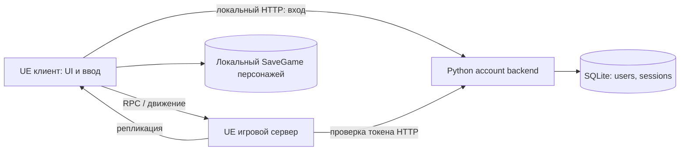

# OnlineTower — состояние, архитектура и план команды

> Последующее изменение 2 ноября: по новому запросу реализованы группы до 6 и локальный поиск матча, данж изменён с 4 на 5. Актуальный поток и проверки — [MATCHMAKING_FLOW_RU](MATCHMAKING_FLOW_RU.md). Оценка ниже сохраняет исходный срез до этих изменений; ограничения party3/общего ServerTravel больше не описывают новый поиск.

Срез: **2 ноября 2026 года**. Проверяемая база кода: `75551df`; рабочее дерево перед аудитом чистое. [English version](PROJECT_STATUS_EN.md).

## 1. Где мы сейчас

**Инженерная оценка: локальный сетевой прототип, до завершённого vertical slice первого этажа.** Есть основа для совместной игры, но нет полного цикла «испытание → победа/поражение → однократная награда → сохранение → повторный вход». Процент готовности без согласованного объёма и критериев был бы произвольным.

Продукт первой версии — один этаж. Финал: 12 участников, четыре трио; автоматического заполнения нет, игрок без полного трио к установленному сроку проигрывает. Набор из трёх случайных обычных умений и ульты относится к созданию персонажа, а не к каждому матчу. Приоритет требований: актуальное решение владельца, затем [PROJECT_DIRECTION.md](PROJECT_DIRECTION.md). Этот аудит не меняет правила.

| Область | Реализовано в коде/контенте | Что ещё не завершено |
|---|---|---|
| Запуск и UI | Главное меню, создание/выбор локального персонажа, настройки, пауза, игровой HUD, панель аккаунта/группы | Единый путь от меню к постоянному сетевому персонажу и онлайн-сессии |
| Перемещение | Сетевой CharacterMovement, предсказание спринта, прыжок, серверный перекат | Приёмка при задержках/потерях пакетов; перекат остаётся прототипным |
| Бой | GAS, здоровье, обычная атака, шесть обычных умений в пуле, выдача трёх без повторов, фиксированная ульта, манекены, смерть/возрождение | Полноценные PvE-враги, законченные правила матчей, баланс и финальная анимация |
| Аккаунты | Регистрация, вход, токены, SQLite, проверка личности игровым сервером | Публичный сервис, восстановление доступа, привязка персонажей и прогресса |
| Совместная игра | Репликация, приглашения, принятие/отказ/выход, ожидание у портала, seamless travel одной группы | Независимые экземпляры испытаний, подбор, восстановление после отключения |
| Мир | Отдельные карты меню, офиса-хаба, PvE, дуэли, финала; процедурное окружение, материалы и горы | Игровое наполнение испытаний и приёмка финального качества/производительности |
| Постоянные данные | Локальный SaveGame персонажей; аккаунты отдельно в SQLite | Доверенный серверный персонаж, прогресс этажа, результаты и награды |
| Финал | Карта и описание «12 игроков / 4 трио» | Формирование четырёх команд, сроки, допуск, исход и проверка 12 участников |

Карта испытания и надпись о его правилах не означают реализацию этих правил. Фиксированная ульта ДД «Раскол земли» — временное решение; остальные направления не готовы.

## 2. Какая архитектура

Это **один Unreal runtime-модуль `OnlineTower` с логическим разделением подсистем плюс отдельный небольшой Python HTTP backend**. Сетевой игровой процесс построен на клиент-серверной модели Unreal с серверным определением игровых действий. Это не MMO-платформа и не система микросервисов.

Стрелки отражают существующий прототип на одном ПК; локальный SaveGame не является источником доверенного сетевого прогресса. Прямого подключения UE-клиента к SQLite нет.

Все пути исходников в следующей таблице относительно `OnlineTower 5.8/Source/OnlineTower/`.

| Слой / файлы | Ответственность сейчас |
|---|---|
| `Frontend/TowerFrontend.h/.cpp` | GameInstance, локальные персонажи и версия SaveGame, меню, настройки |
| `Online/TowerAccountSubsystem.h/.cpp` | Клиент HTTP API аккаунтов и состояние входа |
| `Online/TowerPartyComponent.h/.cpp` | Серверная проверка токена, операции группы, приглашения и реплицируемое состояние |
| `World/TowerHub.h/.cpp` | GameMode, PlayerController, HUD, создание игровых объектов; пока объединяет много обязанностей |
| `Gameplay/Character/TowerCharacter.h/.cpp` | Физическое представление, ввод, запросы действий, урон/смерть |
| `Gameplay/Movement/TowerMovement.h/.cpp` | Движение и сохранённые сетевые движения спринта |
| `Gameplay/Abilities/TowerAbilities.h/.cpp` | PlayerState, AbilitySystemComponent, атрибуты, эффекты, способности, пул и набор |
| `World/TowerMaps.*`, `World/TowerWorld.*` | Пути карт, окружение, порталы, готовность группы и переход карты |
| `Trials/TowerTrialCatalog.*` | Описание испытаний: ID, карта, вместимость, признак ключа; не полноценная проверка допуска |
| `Tests/` | Automation-тесты и runtime probes; наличие теста не означает его прохождение |
| Корневой `Backend/server.py` | HTTP account API и SQLite; не игровой сервер |

GameMode принимает серверные решения; PlayerController связывает игрока, ввод и UI; Character — изменяемый avatar; PlayerState содержит GAS и набор. Сохранение PlayerState при seamless travel помогает не потерять набор внутри сессии. **Это не сохранение персонажа между подключениями.**

`TowerTrialGameMode` пока наследует основу хаба без законченных самостоятельных правил испытаний. Собственного реплицируемого GameState для фаз матча, четырёх команд и результата нет. Система ещё не полностью управляется данными: каталог описывает контент, но логика также использует индексы испытаний и конкретные классы.

## 3. Нужна ли база данных для мультиплеера

**Для движения, репликации, боя и одного временного матча БД не обязательна. Для постоянных аккаунтов, персонажей, прогресса и наград нашей игры — нужна. Она уже есть, но пока обслуживает только аккаунты и сессии авторизации.**

Текущий backend: Python standard library, HTTP на `127.0.0.1:18080`, SQLite `Backend/data/tower.sqlite3`. Таблицы `users` и `sessions`; пароли хешируются с солью PBKDF2, хранятся хеши токенов. Подробности API: [Backend README](../Backend/README.md). Такая реализация предназначена для локального прототипа; loopback адрес на другом компьютере укажет уже на тот компьютер.

| Данные | Владелец сейчас | Целевой владелец — предложение |
|---|---|---|
| Позиция, HP, откаты, активные эффекты | UE сервер / репликация | UE сервер; не писать каждый тик в БД |
| Аккаунт и auth-сессия | Backend SQLite | Backend через API |
| Локальный персонаж и стабильные ID умений | SaveGame клиента | Сохранить как отдельный offline-режим либо явно определить миграцию |
| Сетевой персонаж | Набор в PlayerState, новая выдача при новом состоянии | Backend: персонаж принадлежит аккаунту, набор создаётся один раз |
| Группа, приглашения, готовность | Память игрового сервера | Runtime-состояние; отдельный контракт восстановления при необходимости |
| Результат, награда, доступ к этажу | Законченного хранения нет | Транзакционная запись backend от доверенного игрового сервера |

Ближайшее решение — расширить существующую границу backend API, а не менять СУБД ради самого факта мультиплеера. Выбор промышленной СУБД и хостинга отложить до требований по параллельным серверам, нагрузке, резервированию и эксплуатации. SQLite можно оставить для локальной разработки; его наличие не доказывает готовность публичного сервиса.

Предлагаемый контракт хранения: `AccountId → CharacterId`, направление, версия схемы/контента, три ID обычных способностей и ID ульты, прогресс; отдельно `MatchId`, результат и уникальная операция награды. Повтор одного результата не должен выдавать награду повторно. При создании и восстановлении сервер проверяет владельца и валидность ID. Клиент не выбирает себе произвольный набор и не записывает победу. Конкретная схема и API ещё не реализованы.

## 4. Главные разрывы и риски

1. **Постоянный сетевой персонаж отсутствует.** Standalone восстанавливает локальный набор; новое сетевое PlayerState получает серверную случайную выдачу. Это пока не выполняет правило постоянного набора из PROJECT_DIRECTION.
2. **Группа, команда и состав матча пока смешаны.** Максимум группы — 3; смена отдельной карты требует, чтобы все подключённые игроки находились в одной готовой группе. Поэтому существующий путь не покрывает PvE на 4 и финал 12/4×3. Нужно определить Party (совместный вход), Team (сторона боя), MatchRoster (все участники) и их связи.
3. **Один сервер — одна текущая карта.** ServerTravel переносит весь мир. Посторонний игрок блокирует переход; это полезная защита, но не маршрутизация групп в отдельные инстансы.
4. **Нет законченного испытания.** Манекены, телепорт и смерть/respawn не заменяют цели, завершение матча, итог и награду. PvP сейчас ограничен дуэльной зоной; правила боя финальных команд ещё нужны.
5. **Локальная авторизация не равна публичной инфраструктуре.** Нужны отдельные решения по защищённому транспорту, конфигурации адресов, доверенным игровым серверам, жизненному циклу сессии, reconnect и эксплуатации.
6. **Проверки ещё не закрывают продукт.** Нет подтверждённой этим аудитом packaged/Shipping сборки, интернет-прогона, 12 игроков, длительной нагрузки и целевых показателей производительности.

Дополнительные технические границы: проверка аккаунта защищает операции группы и портал, но не является обязательной проверкой допуска до появления игрока в мире. Уникальность аккаунта проверяется в пределах текущего мира. При восстановлении после travel здоровье и откаты сбрасываются — контракт будущего матча ещё нужно определить. В исходниках есть Game и Editor targets, отдельного Server target нет; локальный тест запускает `UnrealEditor.exe -server`, а не готовую packaged dedicated-server поставку. Версия SQLite-схемы обозначена, но полноценная последовательность миграций ещё не реализована.

## 5. Этапы разработки для будущей команды

План ниже — техническое предложение; критерии являются будущей приёмкой, а не заявлением о выполнении. Сроки и стоимость требуют согласованного объёма.

| Этап | Результат и ответственность | Критерий завершения |
|---|---|---|
| 0. Зафиксировать воспроизводимую основу | Координатор + C++/QA: версия движка, сборка, запуск, журнал проверок | Новый разработчик собирает проект, запускает backend и двух клиентов по инструкции |
| 1. Контракты персонажа и матча | Архитектор + networking + владелец: Account/Character, Party/Team/Roster, фазы, состояние при travel/disconnect | Согласованы владельцы данных, API, нерешённые правила и сценарии отказов |
| 2. Постоянный сетевой персонаж | Backend + C++: создание/выбор/загрузка, версионные данные, серверная выдача | После отключения и перезапуска сервиса тот же аккаунт получает тот же CharacterId и набор; чужой персонаж недоступен |
| 3. Одно законченное испытание | Gameplay + networking: цель, серверный исход, возврат; backend: результат и награда | Два клиента проходят один цикл; повтор запроса не удваивает награду; прогресс восстанавливается при входе |
| 4. Раздельные экземпляры и полный PvE/дуэль | Networking/backend: размещение и travel; gameplay: PvE на 4, 1v1 | Одна группа входит в испытание, другая остаётся в хабе; проверены 4 участника PvE и исход дуэли |
| 5. Финал первого этажа | Архитектор/gameplay/networking: четыре трио, таймер, допуск, исход | Реальный прогон 12 участников: неполное трио проигрывает, автозаполнения нет, одна победившая команда и однократная фиксация результата |
| 6. Приёмка vertical slice | QA + все роли: полный путь, ошибки сети, повторный вход, packaged build, арт и производительность | Первый этаж проходится от входа до результата; подтверждены согласованные бюджеты кадра/сервера и сценарии отказов |
| 7. Подготовка внешнего теста | Backend/operations/networking: размещение, защищённый доступ, журналирование, backup/restore | Воспроизводимая развёртка, проверка восстановления и игра с отдельных ПК через выбранную инфраструктуру |

Артисты могут параллельно улучшать согласованные локации после фиксации размеров и игрового назначения. Создание следующих этажей, гильдий, аукциона и новых классов не является приоритетом перед завершением первого цикла.

**Ближайший рекомендуемый пакет работ:** этап 1 и затем 2–3. Сначала связать аккаунт с постоянным персонажем и сделать одно испытание с сохраняемым результатом. Для дальнейшего PvE/финала заранее разделить Party/Team/Roster; не пытаться решить это только увеличением константы размера группы.

До реализации соответствующих правил владелец должен определить: способ получения ульты; допустимые наборы и направления; допуск к финалу; срок формирования трио; поведение при выходе/отключении; право оставшихся продолжать после смерти союзника. Вопросы остаются открытыми, а не заменяются решениями аудитора.

## 6. Как новому разработчику войти в проект

1. Прочитать `AGENTS.md`, [PROJECT_DIRECTION](PROJECT_DIRECTION.md), этот документ, [AGENT_TEAM](AGENT_TEAM.md), [MULTIPLAYER_IMPLEMENTATION](MULTIPLAYER_IMPLEMENTATION.md), [Backend README](../Backend/README.md). Старые GDD/TechDoc — дополнительный контекст.
2. Открывать только `OnlineTower 5.8/OnlineTower.uproject`. В `.uproject` указано `EngineAssociation=5.8`; исторические прогоны выполнены на UE 5.8.4. Перед сборкой проверить фактическую установленную версию и C++ toolchain. Git LFS настроен для `.uasset/.umap`; при новом checkout получить бинарные объекты.
3. Для ручной локальной игры запустить `OnlineTower 5.8/Start-LocalBackend.cmd`, открыть `/Game/Maps/Hub/L_Hub`, выбрать PIE: 2 игрока, Listen Server, New Editor Window. В каждом окне войти отдельным аккаунтом через Esc → ACCOUNT / PARTY, пригласить/принять и вместе войти в портал. Подробности и ограничения — в MULTIPLAYER_IMPLEMENTATION.
4. Не считать обычную кнопку входа из главного меню подключением к публичному серверу: offline-профиль и сетевой аккаунт ещё не объединены. В текущем `DefaultEngine.ini` и игра, и редактор стартуют с меню; сервер — с хаба.
5. Для автоматического прогона закрыть свой backend, освобождая 18080, затем выполнить из корня `& './OnlineTower 5.8/Scripts/Test-PartyMultiplayer.ps1'`. Скрипт создаёт отдельную БД и свои процессы. `Test-MapFlow.ps1` проверяет standalone-переходы, а не сетевые инстансы.
6. Работать в назначенных файлах: один автор на файл/ассет. Сборки, Live Coding, импорт и сохранение карты — последовательно. Не менять бинарные ассеты текстом и не очищать чужие изменения.

Карта ответственности будущей команды: архитектор — контракты; Unreal C++ — бой и gameplay; networking — репликация/travel/сессии; backend — профили и результаты; QA — воспроизводимые сценарии; level/concept/3D — окружение и ассеты. Текущий состав профилей агентов не означает наличие специалистов backend, QA и operations: эти обязанности необходимо назначить людям или отдельным задачам.

## 7. Что проверено именно этим аудитом

- Прочитаны исходники, конфигурация, скрипты, документы и состав карт; выполнены независимые архитектурный и сетевой обзоры. Изменения ограничены документацией.
- **2 ноября:** заново выполнены три `Backend/test_server.py` unittest — **3/3 PASS**, 2,852 с. Первая попытка в песочнице заблокирована `WinError 10013`; повтор вне песочницы успешен. Использовались временные БД, реальные аккаунты не изменялись.
- В существующих логах `OnlineTower 5.8/Saved/Logs/PartyProbe-1031100904/` проверены `WAIT_PASS`, `SERVER_PASS` и `CLIENT_PASS` обоих клиентов. Это подтверждает сохранённый результат **31 октября**, а не новый сетевой запуск 2 ноября.
- Сборка Editor, automation способностей/профилей, standalone map flow и ручная PIE-проверка описаны в предыдущих отчётах. В рамках этого аудита повторно не выполнялись.
- Живой Unreal MCP среди доступных инструментов не обнаружен; редактор не управлялся. Визуальная проверка, сборка, сетевой runtime, packaged build, нагрузка и 12 клиентов в этом аудите не запускались.

## 8. Актуальность старых документов

`PROJECT_STRUCTURE.md` и `MENUS_AND_PROFILES.md` содержат срез 30 октября: утверждения об отсутствии сетевого перехода/аккаунтов устарели после 31 октября. `ENVIRONMENT_IMPLEMENTATION.md` описывает ранний вариант зон в одной карте. `HUB_MULTIPLAYER.md` сохраняет исторический отчёт и уже содержит оговорку. Для текущего сетевого запуска использовать `MULTIPLAYER_IMPLEMENTATION.md`, для общей оценки — этот документ; фактические пути и поведение сверять с кодом. Исторические проверки не удалять и не переносить на новые версии без повторного прогона.

При каждом завершённом этапе обновлять обе языковые версии: дату, ревизию, реализованное поведение, открытые вопросы, выполненные команды/логи и ограничения. Предложение становится подтверждённым правилом только после решения владельца.
